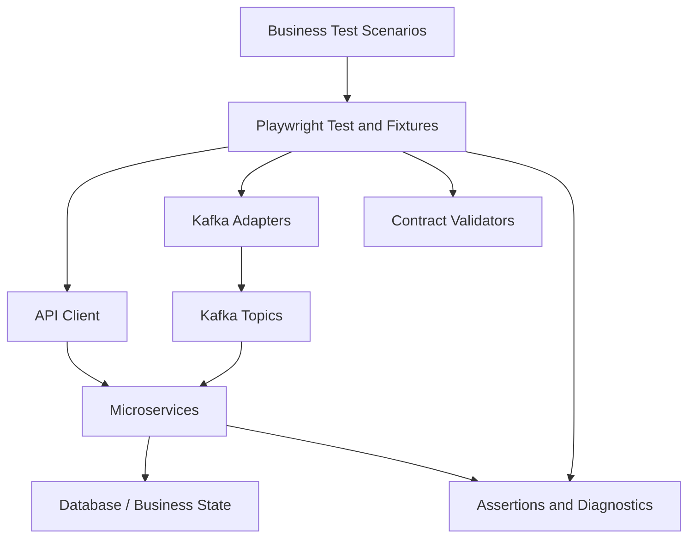

# 🚀 Microservices & Kafka Test Automation Framework

> A TypeScript-based automation framework for validating microservice APIs, Kafka event contracts, asynchronous workflows, and distributed-system resilience.


---

## 📖 Overview

Microservices rarely operate in isolation. A single business transaction may cross multiple APIs, Kafka topics, consumers, databases, and external dependencies. Testing only HTTP responses does not prove that asynchronous processing completed correctly.

**Microservices & Kafka Test Automation Framework** provides a reusable foundation to validate service behavior and message-driven business workflows using Playwright Test, TypeScript, KafkaJS, JSON Schema, and Docker.

The repository is designed as a reference implementation. The sample business domain uses an order-processing flow; replace the example endpoints, topics, schemas, and expected states with those used by your application.

## ✨ Key Features

- **API Testing** — reusable service clients and business-level assertions.
- **Kafka Producer / Consumer Testing** — publish test events and observe asynchronous outcomes.
- **Event Contract Validation** — validate event payloads against JSON Schema.
- **Asynchronous Assertions** — condition-based waiting with deadlines rather than arbitrary fixed sleeps.
- **End-to-End Workflows** — validate a business transaction across API and messaging boundaries.
- **Resilience Test Design** — duplicate delivery, retries, consumer restart, DLQ and recovery scenarios.
- **Correlation-Based Diagnostics** — use unique correlation IDs to trace a test transaction.
- **Docker-First Local Setup** — run a local single-node Kafka broker for development and framework checks.
- **CI/CD Ready** — GitHub Actions workflow template, test reports and artifacts.
- **Layered Architecture** — separate test scenarios from API clients, Kafka mechanics, contracts and fixtures.

> **Status:** Starter/reference framework. End-to-end and resilience scenarios require compatible application services and environment configuration. The sample broker is for local development, not production-grade resilience testing.

## 🧰 Tech Stack

| Layer | Technology |
|---|---|
| Language | TypeScript |
| Test runner | Playwright Test |
| Kafka client | KafkaJS |
| API client | Playwright `APIRequestContext` |
| Event schema validation | JSON Schema + Ajv |
| Local infrastructure | Docker Compose |
| CI/CD | GitHub Actions |
| Reporting | Playwright HTML + JUnit XML |

## 🏗️ Architecture



### Test layers

| Layer | Purpose | Typical trigger |
|---|---|---|
| Unit | Business logic and transformation rules | Every build |
| API / service | Request validation, status and business rules | Pull request |
| Contract | API and event schema compatibility | Pull request / deployment |
| Producer / consumer | Publishing, routing, parsing and processing | Integration CI |
| Integration | Service + Kafka + database interactions | CI |
| End-to-end | Critical business transaction across services | Main branch / pre-release |
| Resilience | Retry, duplicate delivery, DLQ, restart and recovery | Nightly / pre-release |
| Performance | Throughput, latency, lag and backpressure | Scheduled / release |

## 📁 Project Structure

```text
TestAutomationWithKafka/
├── .github/
│   └── workflows/
│       └── automation.yml
├── docker/
│   └── docker-compose.yml
├── src/
│   ├── assertions/
│   │   └── order.assertions.ts
│   ├── clients/
│   │   └── order-api.client.ts
│   ├── config/
│   │   └── env.ts
│   ├── contracts/
│   │   ├── order-created.schema.json
│   │   └── validate-event.ts
│   ├── fixtures/
│   │   └── test.fixture.ts
│   ├── kafka/
│   │   ├── kafka-event-waiter.ts
│   │   ├── kafka-producer.ts
│   │   └── kafka.factory.ts
│   └── utils/
│       ├── correlation-id.ts
│       └── polling.ts
├── tests/
│   ├── contract/
│   │   └── order-created.spec.ts
│   ├── e2e/
│   │   └── order-payment-flow.spec.ts
│   ├── integration/
│   │   ├── order-producer.spec.ts
│   │   └── payment-consumer.spec.ts
│   └── resilience/
│       └── resilience-scenarios.md
├── .env.example
├── .gitignore
├── package.json
├── playwright.config.ts
├── tsconfig.json
└── README.md
```

## ⚙️ Prerequisites

- Node.js 20+ (Node.js 22 recommended)
- npm
- Docker Engine / Docker Desktop with Docker Compose
- Kafka and target microservices for integration and end-to-end tests
- Access to the application test environment and required credentials

## 🚀 Getting Started

### 1. Clone the repository

```bash
git clone https://github.com/kaustubhphatale/TestAutomationWithKafka.git
cd TestAutomationWithKafka
```

### 2. Install dependencies

```bash
npm install
npx playwright install
```

### 3. Configure the environment

```bash
cp .env.example .env
```

Update the API URL, Kafka brokers, topic names and timeouts for your environment. Do not commit credentials or real secrets.

### 4. Start local Kafka

```bash
docker compose -f docker/docker-compose.yml up -d
```

Create the sample topic:

```bash
docker compose -f docker/docker-compose.yml exec kafka \
  kafka-topics --bootstrap-server kafka:29092 \
  --create --if-not-exists \
  --topic orders.created.v1 \
  --partitions 3 --replication-factor 1
```

The Compose configuration exposes `localhost:9092` to host-run tests and `kafka:29092` to containers on the Compose network.

### 5. Run validation and tests

```bash
npm run typecheck
npm run test:contract
npm run test:integration
npm run test:e2e
```

**Important:** Contract tests validate the sample event schema. Integration and E2E tests require the matching application services, API endpoints, Kafka topics and event contracts to be running. Configure them before expecting those tests to pass.

### 6. View the report

```bash
npx playwright show-report
```

JUnit XML and Playwright artifacts are written under `test-results/` and `playwright-report/`.

## 🧪 Example Test Scenarios

### Producer validation
- Create a business entity through the service API.
- Assert the HTTP response and returned identifier.
- Observe the emitted event using a unique correlation ID.
- Validate event schema, metadata and business fields.

### Consumer validation
- Publish a valid event to a test topic.
- Verify the real consumer processes it.
- Assert the resulting business state and follow-up event.

### End-to-end workflow
- Trigger a business operation through the source API.
- Wait for the downstream business state with a deadline.
- Verify the final state and relevant event evidence.

### Resilience and reliability
- Duplicate delivery and idempotency.
- Malformed event and DLQ behavior.
- Retry policy and transient downstream failure.
- Consumer restart and recovery.
- Out-of-order event handling.
- Schema evolution and compatibility.
- Throughput, processing latency and consumer lag.

See [`tests/resilience/resilience-scenarios.md`](tests/resilience/resilience-scenarios.md) for the scenario catalogue.

## ⏱️ Asynchronous Testing Principles

- Start the event waiter before triggering the action that emits the event.
- Correlate events to a unique test transaction.
- Use condition-based polling with an explicit deadline.
- Do not treat broker acknowledgement as proof of consumer processing.
- Validate authoritative business state and side effects.
- Capture topic, partition, offset, event ID and correlation ID for diagnostics.
- Avoid tests that consume from shared topics without an isolation strategy.

Kafka delivery guarantees do not automatically provide exactly-once business effects across external databases or payment systems. Consumers should be idempotent where required, and the automation should verify that invariant.

## 🔁 CI/CD

The GitHub Actions workflow runs type checking, starts local Kafka, runs contract tests, and defines integration/E2E stages. To enable the full pipeline:

1. Add your service containers or connect to an approved test environment.
2. Provision topics, schemas and database state.
3. Configure environment variables and CI secrets.
4. Add readiness checks and publish reports as workflow artifacts.
5. Keep destructive resilience tests in isolated environments.

## 🚦 Quality Gates

- No unapproved event contract incompatibility.
- All critical business journeys pass.
- Duplicate delivery does not cause duplicate business effects.
- Retry and DLQ behavior match the documented service policy.
- Processing latency and consumer lag meet agreed SLOs.
- Failures include enough diagnostics for triage.
- Product defects, test defects and infrastructure failures are classified separately.

Thresholds should be agreed with service owners; avoid arbitrary universal latency targets.

## 🔐 Security and Environment Notes

- Never commit `.env`, access tokens, SASL passwords or certificates.
- Use TLS/SASL for secured Kafka environments.
- The included single-node Kafka broker is for local development only.
- Use isolated topics, test tenants or dedicated test clusters where possible.
- Never run payment or other irreversible operations against production systems.
- Pin and scan container images and dependencies according to your organization's policy.

## 🗺️ Roadmap

- [x] TypeScript / Playwright project foundation
- [x] KafkaJS producer and event waiter examples
- [x] JSON Schema event validation
- [x] Docker Compose local Kafka
- [x] GitHub Actions workflow template
- [ ] Application-specific service containers and health checks
- [ ] Schema Registry integration and compatibility checks
- [ ] DLQ replay and broker recovery automation
- [ ] OpenTelemetry trace correlation
- [ ] Load testing and consumer-lag thresholds

## 👤 Author

**Kaustubh Phatale**  
Test Architect | Quality Engineering | Test Automation | AI & LLM Testing

- GitHub: [@kaustubhphatale](https://github.com/kaustubhphatale)
- AI-powered Test Automation: [Repository](https://github.com/kaustubhphatale/AI-powered-Test-Automation-)

## 📄 License

This project is licensed under the MIT License. See [`LICENSE`](LICENSE).

---

⭐ If this project helps you, consider starring the repository and sharing improvements.
